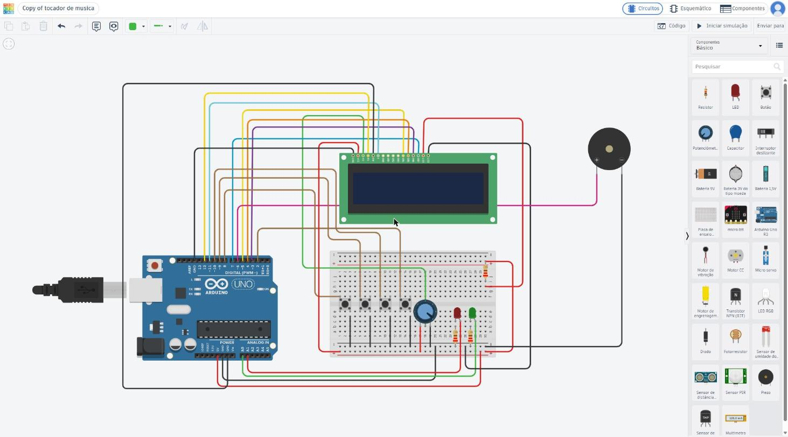

# 🎵 Tocador de Música com Arduino

**Disciplina:** CCP020 — Circuitos e Sistemas Digitais  
**Aluno:** Vinicius Alves de Souza | RA: 52.126.009-1  
**Instituição:** Centro Universitário FEI — Campus São Bernardo do Campo  
**Data:** Novembro de 2026  

---

## O que é o projeto?

Este projeto é um **tocador de músicas portátil** construído com Arduino UNO. Ele reproduz melodias por meio de um buzzer piezoelétrico e permite que o usuário navegue por um repertório de 5 músicas usando 4 botões físicos. Um display LCD exibe o nome da música selecionada e o estado atual do sistema (menu, tocando ou pausado), enquanto dois LEDs coloridos indicam visualmente se a música está tocando ou pausada.

---

## Como funciona?

Ao ligar o sistema, o display LCD mostra a tela de menu com o nome da primeira música disponível. A partir daí, o usuário pode:

- Pressionar **UP** ou **DOWN** para navegar entre as músicas do repertório
- Pressionar **PLAY** para iniciar a reprodução da música selecionada
- Pressionar **PLAY** novamente durante a reprodução para pausar
- Pressionar **STOP** para encerrar a reprodução e voltar ao menu

Enquanto uma música toca, o **LED verde** acende para indicar que o sistema está reproduzindo. Ao pausar, o LED verde apaga e o **LED vermelho** acende. No menu, ambos os LEDs ficam apagados.

A reprodução das notas é feita de forma contínua e fluida: o Arduino gera as frequências sonoras de cada nota usando a função `tone()` e controla o tempo de cada nota com base no relógio interno (`millis()`), sem travar o sistema entre as notas — assim o sistema continua respondendo aos botões enquanto a música toca.

---

## Componentes utilizados

| Componente | Quantidade | Função |
|---|---|---|
| Arduino UNO R3 | 1 | Microcontrolador principal |
| Display LCD 16×2 | 1 | Exibe o nome da música e o estado do sistema |
| Buzzer piezoelétrico | 1 | Gera o som das melodias |
| Botão push-button | 4 | Controle de navegação e reprodução |
| LED verde | 1 | Indica que a música está tocando |
| LED vermelho | 1 | Indica que a música está pausada |
| Resistor 220 Ω | 2 | Proteção dos LEDs |
| Potenciômetro | 1 | Ajuste do contraste do LCD |
| Protoboard | 1 | Conexão dos componentes |

---

## Mapeamento dos pinos

| Sinal | Pino Arduino |
|---|---|
| LCD RS | 12 |
| LCD E (Enable) | 11 |
| LCD D4 | 5 |
| LCD D5 | 4 |
| LCD D6 | 3 |
| LCD D7 | 2 |
| Botão UP | 8 |
| Botão DOWN | 9 |
| Botão PLAY/PAUSE | 10 |
| Botão STOP | 13 |
| LED Verde (tocando) | A1 |
| LED Vermelho (pausado) | A0 |
| Buzzer | 6 |

---

## Repertório de músicas

| # | Música |
|---|---|
| 01 | Brilha, Brilha Estrelinha |
| 02 | Ode à Alegria — Beethoven |
| 03 | Parabéns pra Você |
| 04 | Asa Branca — Luiz Gonzaga |
| 05 | Escala de Dó (teste de hardware) |

As melodias são armazenadas diretamente na memória flash do Arduino (PROGMEM), o que permite guardar as 5 músicas sem sobrecarregar a memória RAM do microcontrolador (limitada a 2 KB).

---

## Estados do sistema

O sistema funciona como uma máquina de estados com três situações possíveis:

```
        [MENU]
           |
    Pressiona PLAY
           |
           v
    [TOCANDO] <----> [PAUSADO]
           |         (PLAY alterna)
           |
    Pressiona STOP
           |
           v
        [MENU]
```

---

## Circuito no Tinkercad

O circuito foi montado e simulado na plataforma Tinkercad:  
🔗 [Abrir circuito no Tinkercad](https://www.tinkercad.com/things/2GIkCjrHh6Y-copy-of-tocador-de-musica)



---

## Arquivos do repositório

| Arquivo | Descrição |
|---|---|
| `tocador_musica.ino` | Código-fonte completo do projeto |
| `circuito_tocador_musica.jpg` | Foto do circuito montado no Tinkercad |
| `README.md` | Este arquivo |
